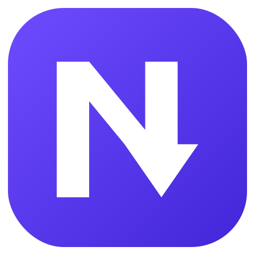

<p align="center"></p>
<h1 align="center">NexGet Download Manager</h1>
<p align="center">A free, fast download manager for Windows, with the IDM layout you already know.</p>

## Features
- **Multi-part downloads.** Each file is split into up to 16 parts that download in parallel (8 by default).
- **Pause and resume**, even after a restart or a dropped connection. Refresh an expired link and continue where it stopped.
- **Browser integration** for Chrome, Edge, Brave, Opera, Vivaldi and Firefox. Downloads of the file types you choose go to NexGet automatically.
- **Download this video.** A button appears on playing videos with a quality menu (1080p, 720p, audio only…). It works on 1800+ sites and on HLS/DASH streams, including players that need their own request headers. DRM-protected videos (Widevine/PlayReady) can't be downloaded by any tool.
- **Queue and scheduler.** Start the queue at a set time and sleep or shut down when it finishes.
- Categories, speed limiter, clipboard monitoring, "download all links", tray icon, start with Windows.
- Small and fast. A 172 KB native app (.NET Framework 4.7.2+, built into Windows 10/11) and an ~18 MB installer.

## Install
Download `NexGet-Setup-x.y.z.exe` from [Releases](../../releases) and run it. No admin rights are needed. On the
last page NexGet finds your browsers and helps you add the browser add-on.

The installer isn't code-signed yet, so Windows SmartScreen may say "Windows protected your PC". Choose
**More info → Run anyway**.

## How it works
| Part | What it does |
|---|---|
| `src/` | The C# app. `Engine.cs` (aria2 for multi-part downloads, yt-dlp for video, queue), `Video.cs` (quality analysis), `Bridge.cs` (local link to the browser add-on on 127.0.0.1:9614), `MainForm.cs` / `Dialogs.cs` / `Theme.cs` (UI), `Browsers.cs` (browser detection, add-on install, yt-dlp updater). |
| `extension/` | Browser add-on (Manifest V3, Chromium and Firefox). |
| `installer/` | NSIS installer script, artwork and signing hook. |
| `store/PUBLISHING.md` | How to publish the add-on to the Chrome, Edge and Firefox stores. |
| `test/` | Engine and UI checks (run with Mono). |

Bundled engines, all open source: [aria2](https://github.com/aria2/aria2), [yt-dlp](https://github.com/yt-dlp/yt-dlp),
[FFmpeg](https://ffmpeg.org) (LGPL remux-only build) and [QuickJS-ng](https://github.com/quickjs-ng/quickjs). See `licenses/`.

## Build
On Linux with `mono-devel`, `mingw-w64` and `nsis`:
```sh
./get-tools.sh                 # Windows engines into dist/tools
sh tools-ffmpeg-build.sh       # small FFmpeg build; copy ffmpeg.exe / ffprobe.exe into dist/tools
./build.sh                     # NexGet.exe, installer/out/NexGet-Setup-*.exe, store/*.zip
```
Signed build on Windows: set `NEXGET_CERT` to your certificate's name, sign `dist\NexGet.exe` with
`installer\sign.cmd`, then `makensis /DSIGN=sign.cmd installer\installer.nsi`.
